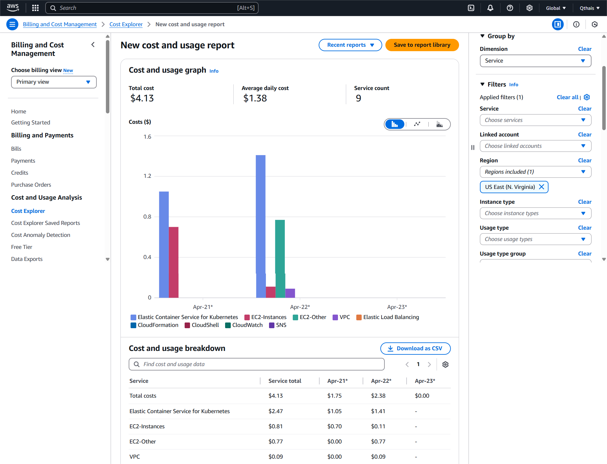

# 🏡 Homybnb ( Production stopped due to AWS pricing )

Homybnb is a modern, scalable short-term rental platform inspired by Airbnb. It allows users to list properties, make reservations, and manage bookings with a seamless and secure experience. Built with a full microservices architecture, it utilizes modern technologies for performance, scalability, and maintainability.
> 📉 Production was paused after evaluating AWS costs for long-term hosting.


---

## 🌐 Live Demo

- **Docker**: [Demo with Docker Compose](https://drive.google.com/file/d/1s774llB1IfXAkFIz5lYs7H-qYhCmyVCF/view?usp=sharing) (This demo hasn't been added the update property functions)
- **Kubernetes**: [Demo with Kubernetes on AWS](https://drive.google.com/file/d/1_Qj-RAC949KyvAMnVrMy4p49T_ml5BQN/view?usp=sharing) ( This demo hasn't been added the payment, update property functions)
---

## 🧰 Tech Stack

[](https://skillicons.dev)

- **Next.js** – Frontend framework for building SSR and hybrid apps
- **Tailwind CSS** – Utility-first CSS for fast and responsive UI
- **Node.js** – Runtime environment for the backend
- **NestJS** – Structured and scalable backend framework with TypeScript
- **PostgreSQL** – Relational database for structured data
- **MongoDB** – NoSQL database for flexible data modeling (e.g. listings)
- **gRPC** – High-performance communication between microservices
- **Microservices Architecture** – Isolated services for auth, listings, bookings, etc.
- **Docker & Docker Compose** – Containerized environment for consistent deployment

---

## 🔐 Authentication

Homybnb uses a hybrid authentication system combining **NextAuth.js** (on the Next.js frontend) with **NestJS JWT**-based backend logic. This allows for secure, stateless session management across services with flexible support for multiple login methods..

### Supported Methods
- 📧 Email & Password (Credentials)
- 🔐 Google OAuth
- 🐱 GitHub OAuth

---

## ✨ Features

- 🛏️ **Create Listings** – Host properties with full customization  
- 🖼️ **Image Upload** – Add photos to showcase your property  
- 🗂️ **Category Selection** – Classify listings (e.g. apartment, villa, cabin) for easier discovery  
- 📍 **Map Location Selection** – Pinpoint property location using interactive map  
- 🧩 **Property Preferences** – Add amenities, guest limits, rules, and more  
- 👁️ **View Listings** – Browse through available properties with detailed previews  
- ❤️ **View Favorite Properties** – Like and save listings to your favorites for easy access  
- 🔍 **Advanced Filtering** – Filter listings by location, category, date, price, and more  
- 📅 **Calendar Integration** – Visual calendar to manage availability and view booking slots  
- ⚠️ **Schedule Conflict Detection** – Automatically prevents double bookings  
- 📆 **Reservations System** – Book properties and manage personal reservations  
- 🧾 **Manage Bookings** – Hosts can view, accept, or reject reservations for their listings  
- ❌ **Delete Listings** – Remove owned properties from the platform  
- 🧑‍💼 **Host & Guest Roles** – Role-based features for property owners and guests  
- 📧 **Email Service** – Automated email notifications for booking confirmations, cancellations, and reminders
- 💳 **Payment Integration** – Secure online payment processing with support for multiple payment methods
- 📱 **Responsive UI** – Works beautifully across mobile, tablet, and desktop

---

## 🛠️ Getting Started 🚀

### 📋 Prerequisites
- 🐳 Docker ([Install Guide](https://docs.docker.com/get-docker/))  
- ⬢ Node.js v20+ ([Download](https://nodejs.org/))  
- 📦 npm/yarn  

---

## 🚀 Setup Guide
**1️⃣ Clone repository**
```bash
# Clone repository
git clone https://github.com/qthais/Homybnb.git
```
---

## 🧩 Environment Variables Setup

You need to create `.env` files for both the **backend** and **frontend** to connect services properly.

---

### 🔐 Backend `.env`

Create a file named `.env` inside the `Homybnb/backend` directory with the following content:

```env
JWT_ACCESS_SECRET= YOUR_JWT_SECRET
JWT_REFRESH_SECRET= YOUR_REFRESH_SECRET
DATABASE_URL= YOUR_AUTH_DATABASE_URL
LISTING_DATABASE_URL= YOUR_LISTNG_DATABASE_URL
RESERVATION_DATABASE_URL= YOUR_RESERVATION_DATABASE_URL
AUTH_GRPC_URL= 0.0.0.0:50051
LISTING_GRPC_URL= 0.0.0.0:50052
RESERVATION_GRPC_URL= 0.0.0.0:50053
```
### 🔐 Frontend `.env`

Create a file named `.env` inside the `Homybnb/frontend` directory with the following content:

```bash
NEXT_PUBLIC_CLIENT_URL= http://localhost:8080
NEXTAUTH_SECRET= YOUR_NEXT_AUTH_SECRET
NEXT_PUBLIC_API_BASE_URL = http://localhost:3000 or EKS_INGRESS_URL (AWS) 
# INGRESS_URL_SAMPLE (LOCAL):  http://192.168.49.2:80
# INGRESS_URL_SAMPLE (AWS): http://k8s-default-homybnba-6001f995fd-979150355.us-east-1.elb.amazonaws.com:80
NEXTAUTH_URL= http://localhost:8080
GITHUB_ID= YOUR_GITHUB_ID
GITHUB_SECRET= YOUR_GITHUB_SECRET
GOOGLE_CLIENT_ID= YOUR_GOOGLE_ID
GOOGLE_CLIENT_SECRET= YOUR_GOOGLE_SECRET
NEXT_PUBLIC_CLOUDINARY_CLOUD_NAME= YOUR_CLOUDINARY_NAME
NEXT_PUBLIC_CLOUDINARY_API_KEY= YOUR_CLOUDINARY_API_KEY
CLOUDINARY_API_SECRET= YOUR_CLOUDINARY_API_SECRET
```


---
## 🖥️ Backend Setup ⚙️

You can run the backend using:

- 🧪 Local development with `npm`
- 🐳 Docker Compose
- ☸️ Kubernetes (Minikube or AWS)

---

### 1️⃣Local Development (Recommended for debugging)
```bash
# Navigate to backend root
cd Homybnb/backend

# Install dependencies
npm install

# Run services individually
npm run start:dev auth
npm run start:dev listing
npm run start:dev reservation
npm run start:dev apigateway
```
### 2️⃣ Docker Compose (Quick Setup)
```bash
cd Homybnb/backend
docker-compose up -d
```

### 3️⃣ Kubernetes Setup (Production-ready)

Homybnb can be deployed using Kubernetes for a production-grade environment. This setup uses `minikube` locally with Docker and deploys microservices from prebuilt Docker Hub images.

---

### 🚀 3.1: Using Minikube with Docker

Ensure you have **minikube** and **kubectl** installed on your machine.

#### 🛠️ Start Minikube with Docker driver

```bash
minikube start --driver=docker
```

#### 🛠️ Apply configmap, secret, deployment and service for each microservices
```bash
kubectl apply -f k8s/auth/auth_configmap.yaml 
              -f k8s/auth/auth_secret.yaml 
              -f k8s/auth/auth_service.yaml

kubectl apply -f k8s/listing/listing_configmap.yaml 
              -f k8s/listing/listing_secret.yaml 
              -f k8s/listing/listing_service.yaml

kubectl apply -f k8s/reservation/reservation_configmap.yaml 
              -f k8s/reservation/reservation_secret.yaml 
              -f k8s/reservation/reservation_service.yaml
```
#### 🛠️ Apply configmap, secret, deployment, service for apigateway
```bash
kubectl apply -f k8s/apigateway/apigateway_configmap.yaml 
              -f k8s/apigateway/apigateway_secret.yaml 
              -f k8s/apigateway/apigateway.yaml

```
#### 🌍 Finally, expose the API Gateway

Depending on your environment, you can expose the **apigateway** either locally or via ingress on cloud platforms like AWS.
### 🧪 Option A: Local Access 
**🧪 3.1.1: Port Forward (Fast Testing)**
```bash
kubectl port-forward service/apigateway 3000:3000
```
**🧪 3.1.2: Local Ingress (Minikube Service)**

Modify the apigateway.yaml, creating the ingress as below and apply again:

```bash
apiVersion: apps/v1
kind: Deployment
metadata:
  name: apigateway
spec:
  replicas: 1
  selector:
    matchLabels:
      app: apigateway
  template:
    metadata:
      labels:
        app: apigateway
    spec:
      containers:
        - name: apigateway
          image: qthais/ms-apigateway-homybnb:2.0
          envFrom:
            - configMapRef:
                name: apigateway-config
            - secretRef:
                name: apigateway-secret
          ports:
            - containerPort: 3000
          resources:
          # Modify following your demand
            requests:
              cpu: 50m
              memory: 32Mi
            limits:
              cpu: 100m
              memory: 64Mi
---
apiVersion: v1
kind: Service
metadata:
  name: apigateway
spec:
  selector:
    app: apigateway
  #here
  type: LoadBalancer
  ports:
    - port: 3000
      targetPort: 3000
      nodePort: 35010
---
apiVersion: networking.k8s.io/v1
kind: Ingress
metadata:
  name: homybnb-ingress
spec:
  rules:
    - host: homybnb.localhost
      http:
        paths:
          - path: /
            pathType: Prefix
            backend:
              service:
                name: apigateway
                port:
                  number: 3000
```
Then run
```bash
minikube service apigateway --url
```
Sample output:
```bash
 minikube service apigateway --url
 http://192.168.49.2:80
```
### 🧪 Option B: AWS

Similar to k8s with minikube, but requiring more setups: 
For detailed setup, refer to the [AWS EKS Quickstart Guide](https://docs.aws.amazon.com/eks/latest/userguide/quickstart.html). Once your EKS cluster is set up, deploy the microservices by applying Kubernetes configurations for each service and expose the API Gateway.

---
## 📱 Frontend Setup

### Prerequisites
- Node.js v20 or later installed
- Backend server running (see Backend Setup section)
- Modern web browser (Chrome, Firefox, or Edge recommended)

### Installation Steps

**1️⃣ Navigate to frontend directory**
```bash
cd Homybnb/frontend
```
**2️⃣ Install dependencies**
```bash
npm install 
```
**3️⃣ Start**
```bash
npm run dev
```

